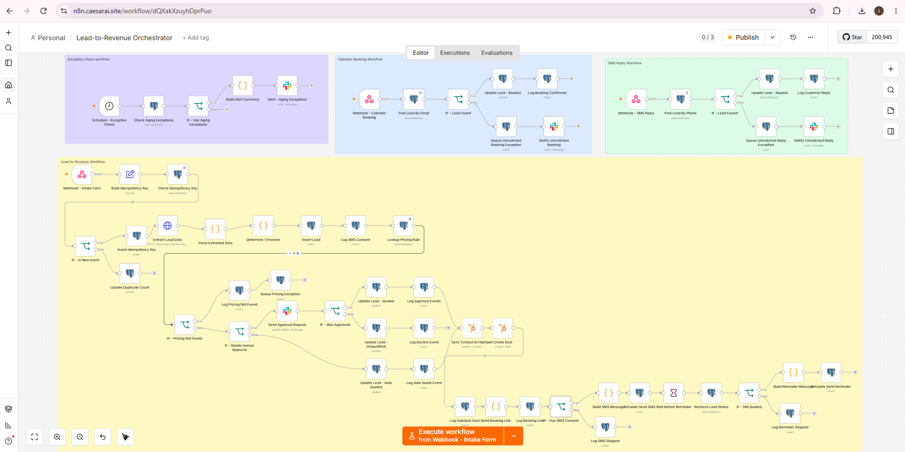
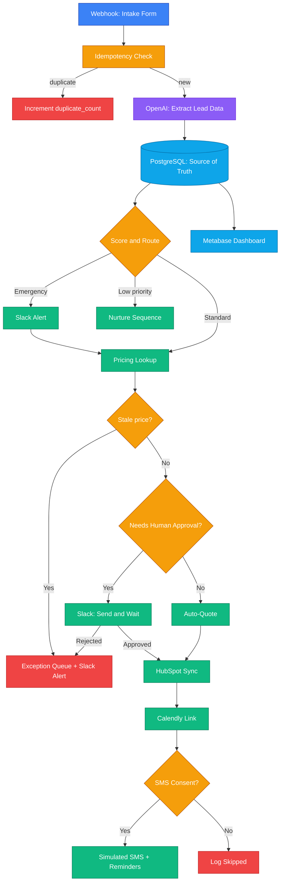

# Lead-to-Revenue Orchestrator

> Turns a raw web-form enquiry into a scored, priced, human-approved, CRM-synced
> booking, automatically, with an audit trail for every decision.

**Built for:** high-ticket home service businesses (HVAC, roofing).

**Stack:** n8n · PostgreSQL (Supabase) · OpenAI · HubSpot · Slack · Calendly · Twilio · Metabase

## The Problem
Home service businesses lose jobs when leads sit unanswered. A customer with a
broken AC calls three companies and hires whoever replies first. Manual data
entry, slow quoting, and missed follow-ups cost real revenue.

## The Solution
This system replies, qualifies, prices, and books automatically, and pulls a
human in only where risk is high (emergencies, large quotes, uncertain AI output).

[▶ Watch the 5-minute walkthrough](https://www.loom.com/share/7eca89be55714ab18f51914f88bc37fa)



## Overview

This project automates lead handling for HVAC/roofing-style service businesses through the following steps: 
- **Ingests leads** — captures leads from a web form
- **Extracts structured data from unstructured text** using OpenAI API (urgency, service type, budget signals, property details) via JSON-mode prompting
- **Scores and routes leads deterministically** — emergency jobs trigger immediate Slack alerts; low-priority leads enter automated nurture sequences
- **Generates dynamic preliminary pricing** from a rules-based pricing engine, with a stale-price guardrail that blocks quotes if pricing data hasn't been verified recently
- **Generates a Calendly booking link and handles booking confirmations** with correct timezone handling between business and customer locations
- **Syncs to CRM (HubSpot)** as a downstream projection of a Postgres source of truth and not the other way around, so CRM downtime never blocks a customer response
- **Routes high-value quotes through human-in-the-loop approval** via interactive Slack buttons before anything reaches the customer
- **Runs compliant automated follow-up** with exact-match STOP/opt-out detection (TCPA-aware) and per-channel consent tracking
- **Tracks its own performance** — speed to first response, cost per lead, routing accuracy — via a Metabase dashboard built on the same event log

## Architecture




## Tech Stack

| Layer | Tool |
|---|---|
| Orchestration | n8n |
| Database | PostgreSQL (Supabase) |
| AI Extraction | OpenAI API (JSON mode) |
| CRM | HubSpot |
| Messaging | Twilio (SMS) |
| Human Approval | Slack |
| Scheduling | Calendly |

## Getting Started

**Prerequisites**
- n8n (self-hosted or cloud)
- Supabase project (PostgreSQL)
- Accounts/API keys: OpenAI, HubSpot, Slack, Calendly

**Setup**
1. Run `database/schema.sql` in your Supabase SQL editor.
2. Import each file in `workflows/` into n8n (Workflows → Import from file).
3. Create credentials in n8n for each service (see list below).
4. Send a test lead:
```bash
   curl -X POST YOUR_WEBHOOK_URL \
     -H "Content-Type: application/json" \
     -d '{"name":"Test","email":"test@example.com","message":"My AC is broken"}'
```

**Credentials needed:** OpenAI API key, Calendly, HubSpot private app token,
Slack app (interactivity enabled), Supabase connection string.

## Example

**Incoming form text:**
> "My AC died last night and it's 38°C in the house. Have a baby at home.
> Need someone ASAP. Budget isn't an issue."

**Extracted by OpenAI:**
```json
{
  "service_type": "AC repair",
  "urgency": "emergency",
  "budget_signal": "flexible",
  "property_type": null,
  "confidence": 0.91
}
```

**Result:** Routed as emergency → instant Slack alert → quote sent for approval.

## Key Engineering Decisions

- **Idempotency, not just deduplication** — every inbound event is fingerprinted
  and logged with a running `duplicate_count`, rather than silently rejected,
  so duplicate-traffic patterns are measurable, not invisible.
- **AI extraction with honest uncertainty** — the extraction prompt is
  deliberately designed to return `null` rather than guess, paired with a
  confidence score that routes low-confidence leads to human review instead of
  being trusted blindly.
- **Genuine human-in-the-loop, not just a notification** — the Slack approval
  step actually pauses workflow execution until a manager responds, using
  OR-combined risk logic (emergency jobs, high-dollar quotes, low AI
  confidence) to decide what needs a human at all.
- **TCPA-aware consent logging** — every SMS consent decision (granted or
  declined) is logged with the exact disclosure text shown, not just a
  true/false flag, for legal defensibility.
- **Swappable messaging layer** — the entire consent-gating and reminder
  system was built and tested against a simulated send step, so connecting a
  real SMS provider is a one-node change, not a rewrite.
- **Nothing fails silently** — unmatched bookings, unmatched replies, and
  pricing gaps all land in a dedicated exception queue with scheduled Slack
  alerts, rather than disappearing.
- **Postgres as source of truth, HubSpot as a projection** - CRM outages shouldn't block customer replies.
  HubSpot downtime delays syncing but never delays a response.
  

## Project Structure

```
workflows/
  Lead-to-Revenue Orchestrator.json
database/
  schema.sql
  views.sql
docs/
  architecture.md
  workflow-screenshot.png
```

## Status & Roadmap

**Working today:** intake, AI extraction, scoring/routing, pricing with guardrail,
Slack approvals, HubSpot sync, consent logging, exception queue, Metabase analytics.

**Intentionally simulated (and why):**
- SMS sending, pending Twilio A2P 10DLC registration. The send step is isolated, so going live is a one-node swap.
- Calendly confirmations use a stand-in webhook (real webhooks need a paid plan).

**Next:**
- [ ] UI for resolving exception-queue items
- [ ] Live SMS via Twilio
- [ ] Real Calendly webhook

## About the Author

**Ifedayo Steven Fakayode**, AI Automation Engineer based in Lagos, Nigeria.

I build automation systems that connect enquiry capture, qualification, CRM,
booking, quoting, and follow-up for service businesses.

Open to remote AI automation roles and consulting.

📧 steven.fakayode@gmail.com · 💼 [LinkedIn](https://www.linkedin.com/in/ifedayofakayode/)
